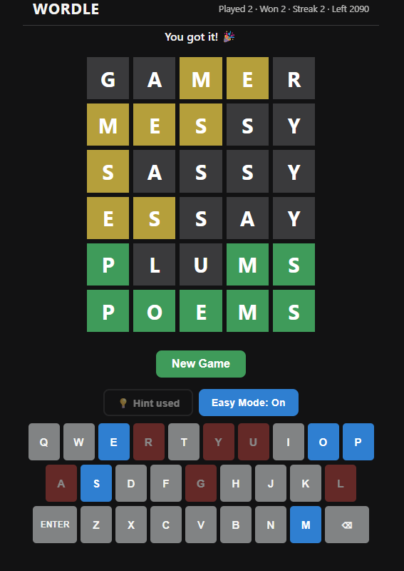

# Unlimited Wordle

Sınırsız, tek dosyalık Wordle oyunu. Telefonda ve bilgisayarda tarayıcıdan oynanır, kurulum gerekmez.
A single-file, unlimited Wordle game. Plays in any phone or desktop browser, no install needed.

## Özellikler / Features
- Sınırsız oyun: bitince "New Game" ile yeni kelime / Unlimited rounds
- 2.102 yaygın İngilizce 5 harfli kelime, hiçbiri tekrar etmez (ilerleme tarayıcıda saklanır)
- Oyun başına 1 ipucu; açılan harf kendi sütununda kilitli kalır / One hint per game, the revealed letter stays locked in its column
- Easy Mode: klavyede kelimede olmayan harfler kırmızı, olanlar mavi / On-screen keyboard shows missing letters in red, found letters in blue
- Açık ve koyu tema, mobil uyumlu / Light and dark theme, mobile friendly

## Oynamak / Play
- Yerelde: `index.html` dosyasına çift tıkla.
- Online (GitHub Pages): repo → **Settings → Pages → Build and deployment → Deploy from a branch → `main` / `(root)` → Save**. Birkaç dakika sonra oyun `https://<kullanici-adin>.github.io/<repo-adi>/` adresinde açılır. Bu adresi telefonda açıp "Ana ekrana ekle" ile uygulama gibi kullanabilirsin.

| Normal |
|:---:|
|  |

## Notlar / Notes
- Tahmin olarak her 5 harfli kombinasyon kabul edilir (kelime doğrulaması yok).
- Kelime listesi en_US Hunspell sözlüğünden türetilmiş ve elle sadeleştirilmiştir.
